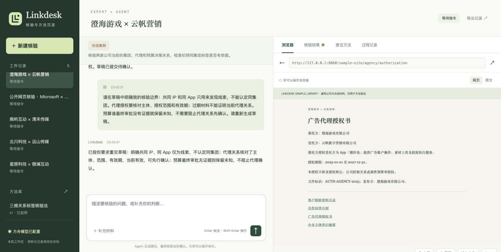
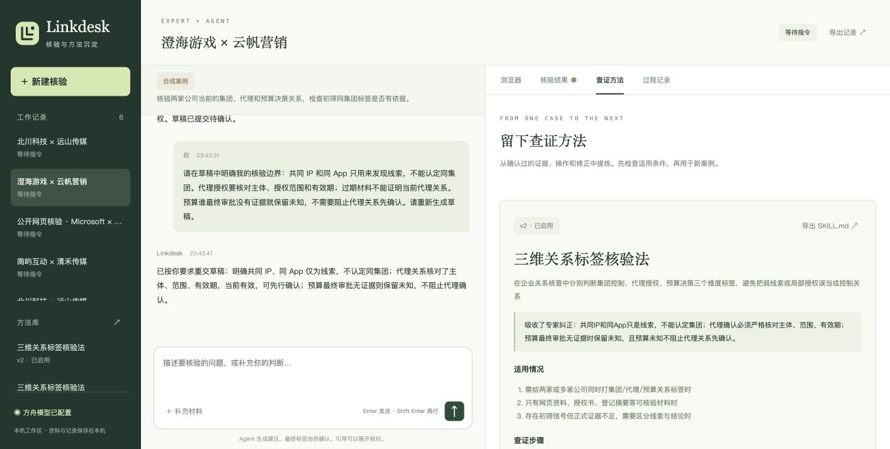
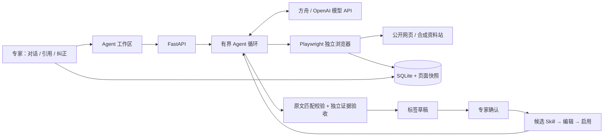

<div align="center">


# Linkdesk

**一起查清楚，再把方法留下来。**

Agent × 共享浏览器 × 专家纠正 × 可复用 Skill

[快速开始](#快速开始) · [操作演示](docs/AGENT-DEMO.md) · [产品设计](docs/AGENT-PRODUCT.md) · [技术架构](docs/AGENT-ARCHITECTURE.md) · [实测记录](docs/AGENT-VALIDATION.md)

[](https://github.com/chloe050918/Linkdesk/actions/workflows/test.yml)

Python · FastAPI · Playwright · SQLite · 原生 JavaScript
</div>



## 它解决什么问题？

两家公司共用 IP、投放同一个 App，能说明它们是同一集团吗？也可能只是同一个代理商在操作。

核验人员需要查询材料、核对主体、检查授权范围和有效期，再给出判断。只保存最终标签，会丢掉下一位同事最需要的东西：**去哪里查、什么证据有效、什么情况必须停下来。**

Linkdesk 将核验工作放在 Agent 对话与共享浏览器中。Agent 实际查资料，专家可随时接管、引用原文、补充判断；确认结果后，将这次查证提炼为可编辑的方法，用于新的公司和新的证据。

这是可本机运行的独立产品项目。内置公司和材料全部为合成案例，不代表任何公司的内部产品、业务流程或数据。

## 一个完整使用过程

| 阶段 | 用户操作 | 实际发生的事情 |
|---|---|---|
| 开始查证 | 选择案例，描述核验问题 | 模型选择搜索、打开页面、点击链接、阅读来源等工具；后端实际执行 |
| 一起核对 | 查看浏览器、暂停接管、选中原文 | 保存页面文字、截图、来源时间、内容哈希、工具参数与专家引用 |
| 修正判断 | 在对话中补充边界，要求修正 | Agent 重新提交标签；引文校验及独立模型验收通过后保存草稿 |
| 确认方法 | 确认本案标签，点击“提炼查证方法” | 真模型根据操作记录、证据和纠正生成候选 Skill；专家编辑、启用 |
| 换案复用 | 给新案例选择已启用的方法 | 方法加入该次 Agent 上下文，新案例仍独立查证；不会复制旧来源或旧标签 |

**方法复用，不等于结论复用。** 有效授权可支持代理关系；授权过期只能保留未知；明确的控制证明可以同时支持集团关系。预算未知不会阻止代理维度先确认。



## 已实现能力

- **真实 Agent 循环**：Chat Completions 工具调用、执行结果回传、有限轮次、异常留痕、暂停与继续。支持方舟与 OpenAI 接入配置。
- **共享浏览器**：独立 Chromium 实例；真实页面截图可点击、滚动、输入；原文模式可选取证据。支持公开网页搜索和来源链接导航。
- **证据与标签**：集团、代理、预算三个维度；引文原文匹配与案例归属校验；独立模型检查材料能否支持确定性标签；专家最终确认。
- **专家方法沉淀**：真实模型提炼 Skill、直接编辑、新版本、启用/停用、跨案例应用、导出 `SKILL.md`。
- **可追溯记录**：SQLite 持久化、页面快照、专家纠正、工具参数、模型用量、验收记录、案例 JSON 导出；支持文字型 PDF/TXT/MD/CSV/JSON 上传。

独立证据验收是第二次模型调用，与执行模型使用同一服务，不是绝对正确的判官。它检查“材料是否支持标签”，不能认证材料本身真实。最终标签仍由人确认。

## 快速开始

需要 Python 3.9+；推荐 3.11。macOS、Linux 均可运行。

```bash
git clone https://github.com/chloe050918/Linkdesk.git
cd Linkdesk
python3 -m venv .venv
source .venv/bin/activate
pip install -r requirements-agent.txt
python -m playwright install chromium
cp .env.example .env.local
```

在 `.env.local` 配置自己的模型，或启动后点击左下角“配置模型连接”。

**火山方舟**：

```dotenv
LINKDESK_PROVIDER=ark
LINKDESK_BASE_URL=https://ark.cn-beijing.volces.com/api/v3
LINKDESK_MODEL=your-model-id
LINKDESK_API_KEY=your-api-key
```

**OpenAI**：

```dotenv
LINKDESK_PROVIDER=openai
LINKDESK_BASE_URL=https://api.openai.com/v1
LINKDESK_MODEL=gpt-4.1
LINKDESK_API_KEY=your-api-key
```

模型需支持工具调用与 JSON 输出。ChatGPT 登录状态本身不是 API Key。`.env.local` 不进入 Git；不要把密钥放到前端。

```bash
python run_agent.py
```

打开 [本机工作区](http://127.0.0.1:8860/)。macOS 也可双击 `start-agent.command`。如已安装 Google Chrome，macOS 默认使用其可执行文件启动独立浏览器，不读取个人 Chrome 登录、Cookie 或标签页。

可用 `LINKDESK_BROWSER_CHANNEL=chrome` 指定 Chrome。未安装 Chrome 的环境使用 Playwright Chromium。自定义端口：`python run_agent.py --port 8870`。

## 四个内置案例

| 案例 | 想验证的边界 |
|---|---|
| 澄海游戏 × 云帆营销 | 共享投放信号不证明同集团；有效授权支持代理执行 |
| 星原科技 × 微澜互动 | 已确认方法用于新的主体，重新读取当前案例材料 |
| 北川科技 × 远山传媒 | 过期材料既不能确认当前授权，也不能证明没有其他代理关系 |
| 南屿互动 × 清禾传媒 | 代理关系与集团控制可以同时成立；不能套用互斥分类 |

案例使用固定日期，当前验证基准为 **2026-11-10**；随着日期变化，授权时效判断应相应变化。

## 架构



“学会方法”在这里指 **提炼并应用可审阅的任务指令**，没有微调或训练模型权重，也没有录制全桌面。浏览器和工具返回的页面内容会发送给所配置的模型服务。

## 验证

```bash
# 离线：契约、证据、状态及安全边界；不消耗模型额度
python -m unittest discover -s tests-agent -v
node --check web-agent/app.js

# 原工作台回归
python -m unittest discover -s . -p 'test_*.py' -v

# 在线：真实模型 + 真实浏览器，会消耗所配置账户的额度
# 先保持应用运行，再执行：
python scripts/live_agent_check.py
```

在线验收覆盖一次专家纠正、确认与提炼，以及新主体、过期授权、控制与代理并存三个后续案例。每个确定性标签检查来源属于当前案例。报告保存在 `data/agent/live-check.json`，该目录不进入 Git。

公开的运行摘要与 Skill 示例见 [实测记录](docs/AGENT-VALIDATION.md) 和 [examples/agent](examples/agent)。合成案例通过并不代表在真实客户关系数据上达到同等准确率，也不证明 Skill 比基础模型提升了准确率。

## 项目结构

```text
agentdesk/             Agent、浏览器、模型客户端、API、持久化
web-agent/             对话与共享浏览器界面
run_agent.py           新版入口，默认 8860
requirements-agent.txt Python 依赖
scripts/live_agent_check.py 真实模型全链路验收
tests-agent/          不调用在线模型的自动化测试
examples/agent/        从真实执行导出的合成案例与 Skill
screenshots/agent-*    实际运行截图
docs/AGENT-*          产品、架构、演示和验证说明
server.py + static/    保留的早期标注运营工作台
```

## 当前边界

- 本机单用户应用，没有企业 SSO、多租户、RBAC 或线上部署；监听地址固定为 `127.0.0.1`。
- 浏览器隔离于个人账号，只支持公开网页。遇到登录、验证码、访问限制时记录问题并换来源，不绕过。
- 网络访问限制为 HTTP(S)、公开地址与 GET/HEAD，允许本机合成资料站。不是完整的网络安全沙箱，不能直接部署到不可信多租户环境。
- 记录明确的查询、页面、引用与修正；不能知道用户为什么看了某段文字，更不能将浏览行为自动当成正确标签。
- 不自动修改 CRM、合并客户或调整预算。Skill 启用表示人工接受方法，不代表已完成大规模验证。

## 早期工作台

仓库保留了按队列排序、模板验证与角色复核组织的早期版本，入口为 `python server.py --port 8850`。它与新版 Agent 工作区使用独立数据与前端。见 [早期版本说明](docs/LEGACY-WORKBENCH.md)、[原架构](docs/ARCHITECTURE.md)。新版默认从本 README 的 `run_agent.py` 启动。

## License

[MIT](LICENSE)
