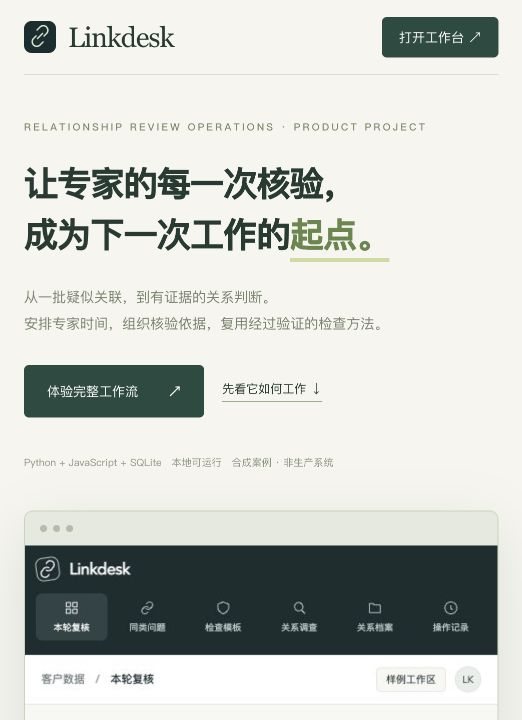
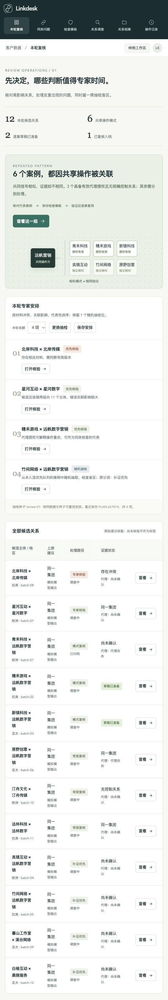
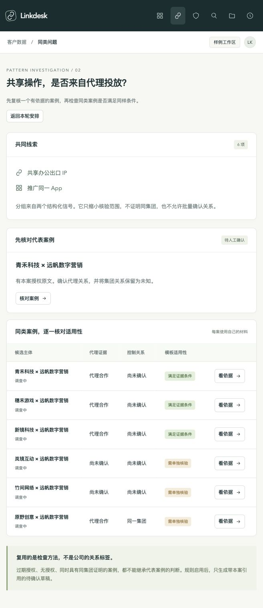
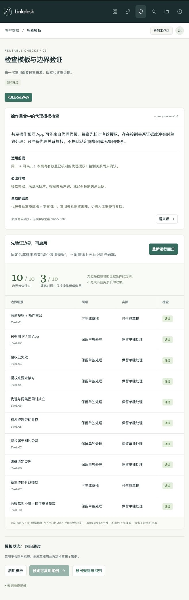
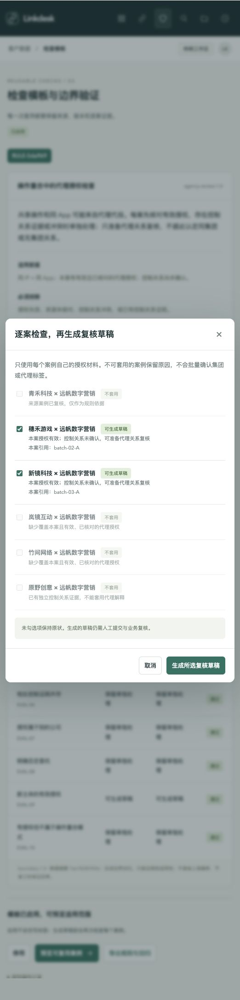
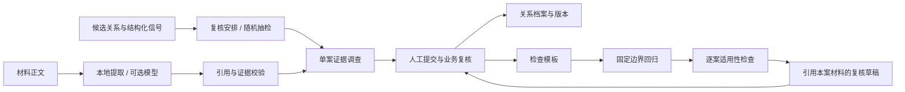

<div align="center">


# Linkdesk

**让专家的每一次核验，都成为下一次工作的起点。**

面向客户关系数据团队的标注运营工作台 · 可运行的全栈产品项目

[产品介绍](docs/PRODUCT.md) · [四分钟演示](docs/DEMO.md) · [本地运行](#本地运行) · [架构与接口](docs/ARCHITECTURE.md) · [验证记录](docs/VALIDATION.md)

[](https://github.com/chloe050918/Linkdesk/actions/workflows/test.yml)

Python 标准库 · Vanilla JavaScript · SQLite · 本地优先

</div>

<p align="center"></p>

## 先看实际产物

| 产物 | 可以看到什么 |
|---|---|
| [已复核关系档案](examples/reviewed-case.md) | 专家最终确认了什么、引用什么、哪些问题仍未知 |
| [可复用检查模板](examples/review-template.json) | 来源、规则版本、边界回归与应用记录 |
| [下一案的复核草稿](examples/prepared-draft.json) | 如何复用检查方法，同时引用下一案自己的材料 |
| [四分钟完整演示](docs/DEMO.md) | 从 12 条候选到代表复核、模板验证与逐案草稿 |

产物由本地合成案例实际运行导出。克隆运行后，可从初始案例重新完成整个过程。

<details>
<summary>展开查看工作台全页截图</summary>



</details>

## 为什么做 Linkdesk

关系模型给出了一批“疑似同集团”的公司。它们共享 IP、推广同一个 App，看起来很像。

但这可能是集团协同，也可能只是同一个代理商在操作。模型产出候选之后，标注人员仍要整理材料，业务专家仍要判断依据。真正稀缺的，是专家能花在这些判断上的时间。

Linkdesk 把这段工作连起来：**安排值得核验的案例，整理每项结论的证据，再将已确认的检查方法安全地复用到后续案例。**

它面向三类使用者：

| 使用者 | 需要完成的工作 | Linkdesk 提供的支持 |
|---|---|---|
| 标注运营负责人 | 分配有限复核名额，发现重复问题 | 可解释排序、同类分组、固定种子随机抽检、安排留存 |
| 标注人员 | 将候选关系整理成可复核任务 | 材料导入、原文引用、关系维度拆分、补证任务、逐案草稿 |
| 业务专家 | 判断证据是否足够，沉淀业务经验 | 聚焦结论与范围的复核、规则来源记录、边界回归、模板启停 |

本项目是独立产品原型，不代表任何公司的内部系统或现有能力。全部公司、材料、图谱规模和上游候选均为合成数据。

## 先用一个完整故事理解它

### 1. 专家本轮只能看四项，先看什么？

首页载入 12 条合成候选关系。系统优先展示相反证据、影响多个主体的关联，以及重复模式的代表案例；保留一个名额，从剩余候选中随机抽检。

排序理由直接显示在案例旁边。这里没有未经校准的“置信度 98%”，也没有把风险、重要程度和模型概率混成一个分数。同一批数据与抽检种子可以重现安排。

### 2. 六个相似案例，为什么不能一起确认？

“同类问题”将共享操作和同 App 的六项候选放在一起。三个有有效代理授权，一个授权过期，一个缺授权，还有一个同时有集团控制证明。

它们可以共享检查方法，却不能共享结论。页面让这些差异直接可见。

<details>
<summary>查看同类问题及不同证据条件</summary>



</details>

### 3. 专家先确认一个具体案例

打开“青禾科技 × 远帆数字营销”。授权书的原文、提供方、日期、适用范围与代理关系判断放在一起。集团关系与预算关系各自保留未知。

提交代理维度，切换到业务复核环节确认，生成带来源和版本的档案。当前由填写姓名模拟角色，尚无真实账号隔离。材料变更后，旧复核失效；原始记录仍保留。

### 4. 把经验变成可验证的检查模板

从这条已复核记录建立模板：共享操作不能直接支持集团判断；每案有有效代理授权、且没有明确控制关系或冲突时，才允许生成代理复核草稿。

模板先运行 10 个固定合成边界场景，包含过期、缺失、主体不匹配、否定授权、同集团反例和材料冲突。全部通过才允许启用。

**这套回归验证的是“模板适用性”，不是关系模型准确率。** 页面里的简化对照只是“按操作相似直接套用”的规则，不是任何生产系统的表现。

<details>
<summary>查看检查模板的边界回归</summary>



</details>

### 5. 复用方法，逐案保留证据

启用后，预览会说明哪些案例可复用、哪些必须排除。确认生成后，穗禾与新镜各得到一份引用自己授权文件的复核草稿。

没有公司标签被自动确认，没有客户、账户或资金被合并。草稿仍需人工提交和业务复核。来源案例撤回、证据变化或规则停用后，规则不能继续生成新草稿。

<details>
<summary>查看逐案适用性检查</summary>



</details>

## 已经可以做什么

| 能力 | 当前实现 |
|---|---|
| 复核安排 | 影响与冲突优先、同类代表去重、保留随机抽检位、保存安排 |
| 证据调查 | 新建双主体调查，TXT / MD / CSV 导入，原文引用，有效期与来源校验 |
| 人工协作 | 补证、部分维度提交、退回、复核、归档、撤回、版本记录 |
| 规则运营 | 已复核来源 → 候选模板 → 边界回归 → 启用 → 适用性预览 → 批量生成逐案草稿 → 停用 |
| 交付与验证 | SQLite 持久化、Markdown / JSON 导出、自动化测试、固定回归数据、CI 配置 |

### 分析能力的真实边界

- **默认可离线运行，使用保守的证据提取规则。** 能处理部分明确中文陈述和字段式文本，不具备通用文档理解能力。
- 支持可选的 OpenAI 兼容模型提取接口；本次没有验通真实在线模型。在线提取仍要经过引用、材料类型、主体、日期与来源校验。
- 同类分组来自结构化信号，排序来自明确规则；当前不是学习式聚类、主动学习或经过校准的概率模型。
- 检查模板使用受约束的内置规则类型，业务人员填写判断依据；当前不支持任意自然语言编译规则或自动训练模型。
- 使用本机模拟角色，没有企业登录、真实职责分离、外部企业搜索、OCR、CRM 写回、自动消息通知或模型训练管线。

## 本地运行

需要 Python **3.9+** 和现代浏览器。无需安装 Python 或前端依赖。

```bash
# 克隆项目后启动
git clone https://github.com/chloe050918/Linkdesk.git
cd Linkdesk
python3 server.py --port 8850
```

打开 **http://127.0.0.1:8850/**。产品介绍页为 **http://127.0.0.1:8850/project.html**。

macOS 可双击 `start.command`。该脚本会检查已有服务并在必要时启动，不会创建公开访问地址。

默认数据保存到 `data/workspace.sqlite3`。刷新和服务重启都保留记录。独立工作区可以使用：

```bash
RELATION_DB=/tmp/linkdesk-sandbox.sqlite3 python3 server.py --port 8851
```

每条样例支持“重新开始”，原记录保留在本机备份中。恢复批次进行完整重演：

```bash
python3 scripts/reset_batch.py
```

该命令只重置 12 条合成批次案例，并停用由它们产生的模板；会保留案例备份、模板与历史记录。不会改变自建调查或旧版单案样例。

### 可选在线模型

配置项示例见 [.env.example](.env.example)。服务**不会自动加载 `.env`**，请在启动进程前通过环境变量注入配置。

```bash
export RELATION_LLM_BASE_URL='https://your-provider.example/v1'
export RELATION_LLM_MODEL='your-model-id'
# 通过本机安全方式设置 RELATION_LLM_API_KEY
python3 server.py
```

配置齐全时，“重新分析”提供在线模型选项。只有选择在线分析，材料正文才会发送给配置的服务；本地规则模式不发送材料。请只上传有权处理的资料。

## 验证项目

```bash
# 运行工作流、证据、分流、回归和模板复用测试
python3 -m unittest discover -s . -p 'test_*.py' -v

# 单独运行固定边界回归，生成可阅读的 JSON 结果
python3 scripts/evaluate.py

# 打包源码、说明、样例和截图，排除运行数据与密钥
python3 scripts/package.py
```

当前结果与浏览器验收记录见 [验证说明](docs/VALIDATION.md)。测试样本检查功能边界，不用于宣称线上准确率或节省工时。

## 架构



前端用原生 JavaScript，后端用 Python 标准库，SQLite 保存案例与运营记录。规则决定授权边界，模型只能提取候选陈述；回归预期结果不参与队列排序。

更多实现细节见 [架构、状态与 API](docs/ARCHITECTURE.md)。

```text
relation-desk/
├── server.py                 # HTTP API、事务、持久化、复核状态
├── engine.py                 # 证据提取与校验、可选模型适配
├── operations.py             # 安排、适用性、边界回归、逐案草稿
├── fixtures.py               # 三个独立调查样例
├── batch_fixtures.py          # 十二条合成运营候选
├── examples/                 # 合成案例实际导出的档案、模板与草稿
├── evaluation/               # 独立的固定边界样本
├── static/                   # 工作台、项目介绍页、样式
├── scripts/                  # 回归、重演、打包
├── docs/                     # 产品、架构、演示、验证
├── screenshots/              # 实际页面截图
├── test_workflow.py           # 证据与人工工作流测试
├── test_operations.py         # 分流、规则与复用测试
└── .github/workflows/test.yml # 可在 GitHub 运行的 CI
```

## 怎样验证业务价值

产品假设是：**在标签质量不下降时，降低每条合格关系消耗的人工时间。** 当前没有真实业务试点数据。

试点应让新旧流程处理难度相当的案例，并独立抽检最终标签；避免同一人重复做同一案例产生记忆优势。

- 主指标：每条抽检合格关系的全链路人力分钟数，单列专家复核时间。
- 协作指标：补证往返次数、退回率、专家需要重新整理材料的比例。
- 质量护栏：错误集团关联、错误套用模板、过度保留未知、过期依据继续使用。
- 抽检指标：未优先处理池的错误类型与分布；不能只统计已确认的容易案例。

## 下一步

接入经过授权的真实脱敏样本，验证业务定义与分流规则；根据抽检结果调整代表案例选择；再接企业身份、外部数据、模型与标签平台。自动确认标签和自动模型训练均不在当前范围内。

## License

[MIT](LICENSE)。示例数据与品牌名称均为虚构，不代表真实商业关系。
